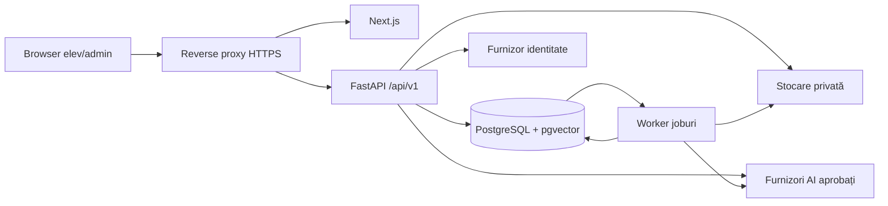

# Guguță — Ghid complet de implementare pentru un LLM

Versiune: 1.0 · 6 septembrie 2026
Scop: instrucțiuni de execuție pentru transformarea fork-ului Open Notebook în MVP-ul Platformei Guguță.
Stare: plan implementabil; niciun test, control de securitate sau deployment nu este considerat finalizat doar pentru că apare aici.

## 0. Instrucțiunea de pornire pentru agent

Citește acest document integral, apoi [specificațiile](SPECIFICATII_GUGUTA.md), [evaluarea tehnică](EVALUARE_OPEN_NOTEBOOK_PENTRU_GUGUTA.md), [analiza OSS](ANALIZA_OSS.md), [checklistul](open-notebook/GUGUTA_IMPLEMENTATION_CHECKLIST.md) și [deployment readiness](DEPLOYMENT_READINESS_CHECKLIST.md).

Lucrează în fork-ul `https://github.com/mariuscerescu/Guguta-Platform`, provenit din `https://github.com/lfnovo/open-notebook`. Punctul local analizat este Open Notebook 1.14.0, commit `8297bb22e2eaeb0d8feafc0538f0d736453571d4`. Nu presupune că fork-ul sau checkoutul curent este încă la acel commit: verifică înainte de modificări.

Obiectivul este o platformă pentru elevii Republicii Moldova cu **Carnete digitale** personale, catalog de carnete preconfigurate, chat cu citări și copiere independentă a materialelor prin link/cod.

### 0.1 Decizii pe care nu le redeschizi fără dovezi noi

- Continuăm fork-ul Open Notebook, fără rescriere integrală.
- Codul Guguță rămâne MIT cu notificările originale.
- Eliminăm SurrealDB și introducem PostgreSQL cu vectori.
- Introducem identitatea, proprietatea și autorizarea în noua fundație.
- Păstrăm Next.js/FastAPI și componentele utile de ingestie, AI și interfață.
- Copiile nu se sincronizează. Share/import transferă materiale, fără chat, notițe sau memorie personală.
- Revocarea linkului împiedică importurile viitoare; copiile finalizate rămân.
- Flashcard-urile, quiz-urile și prezentarea audio sunt ulterioare.

### 0.2 Cum execuți

1. Respectă instrucțiunile sistemului, ale utilizatorului și fișierele AGENTS.md aplicabile. Notează contradicțiile dintre regulile upstream și direcția Guguță; actualizează documentația de proiect în PR-ul fundației.
2. Inspectează starea reală: Git, modificări locale, surse, containere și date. Nu presupune că datele demo sunt dispensabile.
3. Implementează în livrări mici, integrabile. Pentru fiecare: problemă, modificare, teste, rezultat, limite și următorul pas.
4. Execută verificările aferente înainte de a bifa un element. Nu folosi starea „gata” pentru teste neexecutate sau pentru UI cu backend simulat.
5. Nu opri lucrul la un plan dacă ai primit mandat de implementare. Continuă cu părțile independente când lipsesc secrete sau decizii de producție.
6. Nu inventa chei, conturi cloud, domenii, drepturi asupra manualelor sau rezultate de teste.
7. Nu șterge volume, nu reseta istoricul și nu suprascrie munca existentă. Upgrade-urile necesită backup verificat.
8. Nu publica și nu face deployment în producție doar pentru că ghidul descrie procedura. Execută aceste operații numai în mandatul primit; pregătește artefactele și runbookul în prealabil.
9. Nu folosi Computer Use. Verificările UI se fac prin teste automate din proiect și, când este necesar, revizie umană.
10. Nu căuta și nu afișa secrete existente în calculator. Cere doar configurarea secretelor necesare, în mediu/secrets manager.
11. La întrerupere, lasă un raport de reluare cu commit, fișiere, comenzi, rezultate, blocaje și următoarea acțiune concretă.
12. Păstrează specificațiile ca autoritate pentru comportament. Acest ghid alege implementări de lucru, nu introduce aprobări fictive ale inițiatorului.

Documentele din directorul părinte trebuie incluse într-un singur set versionat în fork, recomandat `docs/guguta/`, la PR-ul documentar. Actualizează legăturile și desemnează acea locație ca sursă canonică după mutare; nu întreține două copii care evoluează separat. În livrarea curentă, documentele canonice rămân la căile din linkurile de mai sus.

## 1. Arhitectura de lucru

| Zonă | Alegere inițială |
| --- | --- |
| Frontend | Next.js App Router, React, TypeScript, Tailwind și componente Radix existente |
| API | FastAPI, Pydantic, contracte REST versionate |
| Persistență | PostgreSQL 17, cu patch suportat și imagine fixată la implementare; pgvector compatibil |
| DB Python | SQLAlchemy 2 async, psycopg 3 și Alembic |
| Joburi | Tabel PostgreSQL durabil și worker Python separat; fără Redis ca dependență implicită |
| Chat | Mesaje în PostgreSQL; reconstrucție explicită a contextului autorizat |
| Checkpointuri | Numai dacă sunt necesare: PostgreSQL și domeniu utilizator/carnet/sesiune/revizie |
| Fișiere | Adaptor privat; filesystem în development, object storage sau volum privat cu backup în pilot |
| Identitate | Adaptor OIDC Authorization Code + PKCE, sesiuni opace server-side |
| Testare | pytest, Vitest și Playwright CLI; PostgreSQL real pentru integrare |
| Livrare | Imagini proprii construite din commit, Compose local/staging/pilot limitat |
| Observabilitate | Loguri structurate, metrici API/worker/AI și alerte |

Acestea sunt alegeri tehnice de lucru pentru a evita blocarea în comparații. În prima livrare scrie ADR-urile și verifică compatibilitatea/licențele versiunilor efective. Nu introduce Kubernetes, microservicii, un nou motor de căutare sau organizații școlare dacă nu există o nevoie măsurată.

PostgreSQL permite `SKIP LOCKED` pentru evitarea rândurilor revendicate de alți consumatori, dar această opțiune nu rezolvă singură durabilitatea, retry-ul sau unicitatea efectelor. SQLAlchemy oferă integrare PostgreSQL/psycopg; confirmă API-ul async pentru versiunea fixată. [PostgreSQL SELECT](https://www.postgresql.org/docs/17/sql-select.html), [SQLAlchemy PostgreSQL](https://docs.sqlalchemy.org/en/20/dialects/postgresql.html).

### 1.1 Topologie

În producție browserul folosește aceeași origine pentru UI și API. Baza, workerul și stocarea nu sunt publice. API și worker au configurații și privilegii explicite. Migratorul folosește un rol distinct.

### 1.2 Organizarea codului

Extinde structura existentă, fără mutări cosmetice masive:

- `api/routers/`: validare HTTP și apelare servicii;
- `api/services/`: cazuri de utilizare, tranzacții și politici;
- `open_notebook/domain/`: tipuri și reguli de domeniu;
- `open_notebook/database/`: SQLAlchemy, repositories și migrații;
- `open_notebook/auth/`: actor, sesiuni, permisiuni și adaptor OIDC;
- `open_notebook/storage/`: interfață de stocare și implementări;
- `open_notebook/jobs/`: revendicare, lease, retry și handlers;
- `open_notebook/graphs/`: fluxuri AI adaptate;
- `frontend/src/`: păstrează organizarea existentă și separă ecranele de administrator;
- `tests/`: unit/integration și fixture-uri sintetice;
- `docs/guguta/`: specificații, ADR-uri, dovezi și runbookuri după versionarea setului;
- `scripts/`: pornire, verificare, backup/restaurare și smoke tests.

Rutele nu emit SQL arbitrar. Repository-urile private cer un ActorContext sau un scope validat, nu doar un ID. Operațiile de administrare și publicare folosesc servicii separate; nu dezactiva filtrarea într-o funcție generică printr-un flag trimis de client.

## 2. Primul inventar și protejarea datelor

Execută numai inspecții relevante; nu include conținutul documentelor utilizatorului în rapoarte:

- branch, HEAD, remote-uri, diff și fișiere necomise;
- AGENTS.md, VISION.md, pyproject/lockfile, package/lockfile, Compose și Dockerfile;
- imports SurrealDB/surreal-commands, interogări inline, migrații și ID-uri table:id;
- persistența SQLite din graphs/chat.py și graphs/source_chat.py;
- locațiile volumelor notebook_data/surreal_data și fișierelor încărcate;
- existența, fără citirea în raport, a secretelor necesare recuperării cheilor criptate;
- endpointurile și funcțiile păstrate/administrative/amânate.

Configurează checkoutul existent astfel încât origin să indice fork-ul și upstream proiectul original, după verificarea remote-urilor. Nu clona peste directorul existent. Nu împinge codul în upstream.

Fă snapshot/backup coerent înainte de migrare. Nu copia fișierele interne ale unei baze în timp ce aceasta scrie, fără mecanism de snapshot suportat sau oprire coordonată. Păstrează o instanță separată de dezvoltare cu date sintetice.

Creează `MIGRATION_INVENTORY.md` cu sursa fiecărui tip de date, maparea țintă și verificarea reconciliată. Transferul datelor personale existente necesită proprietar desemnat și decizie explicită; nu le publica în seed-uri.

## 3. Schema și migrațiile

Numele canonice sunt în §9 din specificații. Folosește UUID-uri generate pe server, timestamptz UTC, chei străine, constrângeri și indici pentru relațiile efectiv interogate. Evită dublarea arbitrară a owner_id pe toate rândurile fără verificarea consistenței.

### 3.1 Tabele și constrângeri minime

| Grup | Cerințe |
| --- | --- |
| User / Identity / Session | Identitate unică pe issuer + subject; stare cont; roluri; hash token sesiune, expirare/revocare |
| DigitalNotebook | owner_id obligatoriu, titlu nevid, stare, context_revision, referință de proveniență opțională |
| SourceAsset | hash verificat pe server, locator privat, MIME detectat, dimensiune, stare retenție |
| MaterialVersion | asset_id și metadate versionate; versiunile publicate nu se modifică |
| NotebookSource | carnet + material_version + nume/ordine locale; ID diferit în fiecare copie |
| ProcessingArtifact | material_version, parser/config/chunker, stare și checksum rezultat |
| Chunk | artifact_id, ordine unică în artefact, text și locator pagină/slide/secțiune |
| Embedding | chunk_id, embedding_space_id, vector cu dimensiunea configurată |
| Template / TemplateVersion | metadate catalog și versiune publicată; manifest ordonat și imuabil |
| ShareSnapshot / ShareMaterial | autor, stare, schema_version, materiale fixate; fără date private de chat |
| ShareCredential | hash/HMAC token/cod și snapshot_id; același snapshot pentru ambele |
| ShareImport / IdempotencyRecord | actor + tip operație + cheie unice, hash payload și rezultat; fără unicitate permanentă actor + snapshot |
| ChatSession / Message / Citation | carnet autorizat, context_revision, ordonare și surse locale; statusul generării |
| Note / SourceInsight | date personale; fără includere implicită în snapshot |
| ProcessingJob | țintă/revizie, actor, payload minim, stare, lease, attempts, deadline |
| AuditEvent | actor, acțiune, țintă, rezultat și request_id; fără document/token implicit |

Un manifest JSON poate exista ca reprezentare de API, dar referințele la materialele păstrate trebuie să fie verificabile prin FK-uri/servicii și folosite de garbage collector. Nu ascunde toate referințele într-un JSON neverificat.

Migrațiile pornesc de la zero și se testează și din versiunea anterioară Guguță. Exportul SurrealDB este o operație separată, nu o migrare Alembic pretins automată. Nu executa migrațiile concurent din fiecare worker/API la pornire: folosește un job unic de release.

### 3.2 Autorizare și RLS

Implementarea de bază verifică actorul și relațiile în servicii și interogări. Pentru tabelele personale adaugă RLS ca apărare suplimentară, cu:

- rol runtime fără superuser/BYPASSRLS și fără proprietate asupra tabelelor;
- politici pentru acces propriu și trasee distincte pentru operații de sistem;
- context de actor setat server-side cu `SET LOCAL` în tranzacție;
- fără persistența actorului în conexiunea reciclată de pool;
- teste pe două conexiuni/actori, inclusiv după rollback și reutilizarea conexiunii;
- rol migrator separat; workerul are acces controlat la coadă și setează actorul validat pentru datele personale.

Furnizorul de identitate nu controlează direct owner_id. Rolul editor nu primește acces universal la carnete. Pentru SourceAsset/artefacte comune, accesul se dovedește printr-o asociere autorizată ori prin serviciul de instanțiere/import. Nu crea o politică de tip „orice utilizator autentificat poate citi toate materialele comune”.

ADR-ul descrie politicile efective și rolul folosit de fiecare proces. Nu considera RLS activ doar fiindcă există un fișier SQL.

## 4. Identitate și sesiuni

Folosește o bibliotecă OIDC matură. Implementează:

- Authorization Code + PKCE, state și nonce;
- verificarea issuer, audience, semnăturii și expirării răspunsurilor;
- asociere pe issuer + subject, fără contopire automată doar pe email;
- sesiune opacă cu entropie suficientă, token hashuit pe server;
- cookie HttpOnly, Secure în HTTPS, SameSite potrivit fluxului și Path restrâns unde este posibil;
- protecție CSRF pentru mutațiile bazate pe cookie, verificarea Origin;
- expirare inactivitate/absolută, logout și invalidarea sesiunilor la blocarea contului;
- fără tokenuri de autentificare în localStorage;
- mesaje generice pentru acces refuzat și limitarea abuzului.

Nu implementa parole proprii în MVP dacă identitatea este delegată. Recuperarea accesului se configurează la furnizor. Alegerea furnizorului și regulile pentru minori sunt decizii de pilot.

Pentru teste folosește un issuer/furnizor fals controlat. Pentru dezvoltare poate exista login cu utilizatori sintetici numai într-un mod explicit local, fără secrete reale. Startup-ul în staging/production trebuie să refuze modul de autentificare de test. Lipsa furnizorului nu autorizează dezactivarea securității în mediul public.

## 5. API și contracte

Folosește `/api/v1` pentru contractele Guguță. Dacă păstrezi rute upstream, pune-le pe un allowlist de compatibilitate, aplică aceleași permisiuni și scrie teste. Rutele neportate se dezactivează. Nu lăsa vechile endpointuri globale disponibile în paralel.

### 5.1 Operații propuse

| Operație | Metodă/rută de lucru | Reguli |
| --- | --- | --- |
| Profil curent | GET /api/v1/me | Actor din sesiune |
| Carnete personale | GET/POST /api/v1/notebooks | Listă paginată, owner din server |
| Carnet individual | GET/PATCH/DELETE /api/v1/notebooks/{id} | Proprietate; concurență la editare |
| Upload/text | POST /api/v1/notebooks/{id}/sources | Limite, MIME, job și revizie |
| Material local | GET/PATCH/DELETE /api/v1/notebooks/{id}/sources/{sourceId} | Relația cu carnetul se verifică |
| Download | GET /api/v1/notebooks/{id}/sources/{sourceId}/download | Fără cale arbitrară sau asset ID liber |
| Notițe | GET/POST/PATCH/DELETE în carnet | Private |
| Căutare | POST /api/v1/notebooks/{id}/search | Selecție autorizată, corpus delimitat |
| Sesiuni chat | GET/POST /api/v1/notebooks/{id}/sessions | ID server-side |
| Mesaj | POST /api/v1/notebooks/{id}/sessions/{sid}/messages | Idempotency, revizie, streaming |
| Catalog | GET /api/v1/templates | Numai publicate pentru public |
| Instanțiere | POST /api/v1/templates/{id}/instances | Fixarea versiunii curente și tranzacție |
| Administrare catalog | /api/v1/admin/templates/... | Editor/admin și audit |
| Creare share | POST /api/v1/notebooks/{id}/shares | Materiale selectate, allowlist |
| Preview import | POST /api/v1/imports/preview | Token în corp; metadata minimă |
| Import | POST /api/v1/imports | Revalidare token, cotă, tranzacție |
| Revocare | POST /api/v1/shares/{id}/revoke | Autor și audit |
| Job | GET /api/v1/jobs/{id} | Proprietar autorizat |
| Configurare AI | /api/v1/admin/models și /credentials | Administrator; secrete neexpuse |

Aceste rute sunt contracte de implementat, nu endpointuri pretinse ca existente. Actualizează schema OpenAPI și clientul TypeScript în același PR.

Erori: `code`, mesaj traductibil, `request_id`, detalii sigure. Folosește 401 pentru lipsa autentificării, 403 pentru acțiune nepermisă, 404 pentru obiect inaccesibil când trebuie evitată divulgarea, 409 pentru conflict, 413 pentru fișier mare, 422 pentru date invalide și 429 pentru limite.

Listele au paginare și sortare stabilă. Nu trimite full_text, vectori sau secrete în răspunsurile de listă. Limitele sunt validate și pe server.

### 5.2 Idempotency și concurență

Cererile de instanțiere, import și generare au cheie de operație stabilă la retry. Salvează actorul, hashul payloadului și ID-ul rezultatului în aceeași tranzacție cu efectul local. Aceeași cheie cu alt payload produce conflict.

Importul și revocarea blochează aceeași înregistrare de snapshot într-o ordine consistentă; verificarea stării, cota și crearea copiei se finalizează tranzacțional. Nu se fac apeluri LLM sau copieri lente cât timp lockul este ținut.

Un import deja confirmat se recuperează după timeout chiar dacă linkul a fost revocat ulterior. Un import intenționat nou poate crea alt carnet. Cotele concurente se verifică atomic; două cereri simultane nu pot depăși limita prin verificări separate.

## 6. Stocarea și procesarea documentelor

### 6.1 Adaptorul de fișiere

Definește operații pentru stocare temporară, finalizare, citire autorizată și ștergere controlată. Cheile sunt generate de server; numele original este metadata, nu cale.

Uploadul are limite de flux, tip real verificat, număr de pagini și timeout. Fișierele temporare sunt în afara webrootului. Blochează path traversal, linkuri simbolice care ies din rădăcină, payloaduri comprimate excesiv și formate nepermise.

Pentru pilot, scanarea malware se face în pipeline înainte de starea disponibilă. Parserul rulează cu limite de resurse și fără acces de rețea inutil. Preview-ul folosește text sanitizat sau randare izolată; HTML/scriptul din documente nu se execută.

Nu expune URL-uri permanente publice. Pentru anularea imediată a accesului preferă download proxy autorizat; URL-urile semnate au TTL scurt și limită documentată, fără promisiune de revocare instantanee.

### 6.2 Pipeline

1. Autorizează carnetul și rezervă cota logică.
2. Validează uploadul și scrie într-o zonă temporară.
3. Calculează hash și creează versiunea/asocierea în stare de procesare.
4. În aceeași tranzacție înregistrează jobul durabil; la rollback curăță temporarul prin compensare.
5. Workerul verifică ținta, revizia și drepturile.
6. Extrage text și locatori, fără a pretinde OCR când runtime-ul lipsește.
7. Segmentează cu limite configurabile, păstrând pozițiile.
8. Calculează embeddinguri în loturi cu retry și control de cost.
9. Publică atomic versiunea completă a artefactului/indexului.
10. Marchează materialul gata și eliberează rezervările temporare.

Eșecul unei transformări opționale nu invalidează ingestia reușită. Un PDF cu text gol sau grav incomplet este semnalat, nu indexat ca succes.

Nu deduplica cache-uri de răspuns ori insight-uri personale între utilizatori. Pentru octeți/artefacte neutre deduplicarea este internă și condiționată de compatibilitate; nu afișa „fișierul există deja la alt utilizator”.

### 6.3 Joburi PostgreSQL

Folosește un model de livrare cel puțin o dată. Cerințe:

- revendicare în tranzacție scurtă cu lock/skip locked, apoi commit;
- lease_owner, lease_token, lease_until, heartbeat și număr de încercări;
- workerul execută fără a ține tranzacția deschisă;
- completarea verifică lease_token și revizia țintei;
- un worker expirat nu poate publica după ce jobul a fost revendicat;
- backoff cu jitter, limită de încercări și stare eșuată inspectabilă;
- recuperare după crash și retry manual fără duplicarea artefactelor;
- anularea sau ignorarea joburilor pentru ținte șterse;
- pooluri și concurență configurabile, pornire conservatoare;
- joburile și obiectele de domeniu se creează în aceeași tranzacție.

Dacă ulterior se introduce un broker extern, folosește outbox pentru publicare; nu presupune atomicitate între PostgreSQL și broker. Efectele externe AI pot produce costuri repetate chiar dacă scrierea DB este idempotentă; înregistrează încercările și folosește idempotency furnizorului când există.

## 7. Căutare, RAG și conversații

### 7.1 Index și recuperare

Pornește cu o configurație de embedding fixată, cu model, revizie, dimensiune și strategie de distanță. Nu amesteca vectori din modele diferite. Pentru schimbare creează un embedding_space nou, reindexează și schimbă referința activă după verificare.

Căutarea textuală poate porni de la configurația PostgreSQL simple și normalizare controlată; validează pe română/diacritice înainte de a pretinde stemming românesc. Căutarea semantică este separată. Combinația rezultatelor și rerankingul sunt îmbunătățiri măsurabile, nu presupuneri upstream.

Înainte de recuperare stabilește setul NotebookSource autorizat. Niciun fragment din afara setului nu este transmis modelului. Pentru corpus mic folosește căutare vectorială exactă filtrată; indexul aproximativ se introduce după măsurare. Filtrarea unui index aproximativ poate reduce numărul rezultatelor, deci testează recall-ul și fallbackul pe setul autorizat. [pgvector](https://github.com/pgvector/pgvector).

Definește bugetele pentru istoric, fragmente, prompt și răspuns. Nu tăia în tăcere la începutul documentului. Trimite titlu, versiune și locator cu fiecare fragment. Rezultatele goale produc un răspuns clar fără surse inventate.

### 7.2 Politica de chat

Promptul de sistem trebuie să definească rolul educațional, clasa, limba, citările și comportamentul când sursele nu sunt suficiente. Instrucțiunile din fișiere nu pot modifica permisiuni sau activa instrumente.

Tutorele poate folosi cunoștințe generale pentru traduceri, gramatică, definiții,
explicații, exemple și metode de rezolvare, fără să ceară ca regula să apară în
material. Paragrafele respective nu primesc citări inventate. Afirmațiile despre
conținutul unei pagini, imaginile sau enunțul unui exercițiu și cererile exclusiv
din surse necesită dovezi autorizate. Generarea și verificarea răspunsului
respectă aceeași regulă; vezi ADR-017.

Nu promite că promptul singur previne prompt injection. În MVP nu activa instrumente cu efect extern ori acces liber la filesystem/web. Datele sunt autorizate înainte de a ajunge la model.

Validează citările: identificator în setul furnizat, asociere locală validă, versiune și locator real. Pentru afirmații verifică susținerea prin evaluări umane/automate separate. Nu fabrica pagini pentru DOCX.

Salvează răspunsul cu status, model, versiune prompt, revizie context, surse și tokenuri/cost observat. Estimările se etichetează ca estimări. Nu loga textul complet implicit.

### 7.3 Memorie și streaming

Mesajele PostgreSQL sunt sursa durabilă de adevăr. Pentru MVP simplu reconstruiește contextul pe server; nu prelua automat checkpointul SQLite upstream.

Dacă LangGraph persistence este necesară, izolează namespace-ul derivat pe server, verifică accesul înainte de resume și documentează strategia de ștergere. Documentația LangGraph descrie checkpointuri pe thread; ID-ul threadului nu este un control de acces. [LangGraph persistence](https://docs.langchain.com/oss/python/langgraph/persistence).

Serializează sau respinge generări simultane pe aceeași sesiune pentru a evita istoricul neordonat. Streamingul transmite evenimente tipizate: început, delta, citare, final, eroare/anulare. Nu marchează mesajul complet înainte de salvarea finală.

La schimbarea surselor, context_revision crește; contextul și memoria anterioare nu mai sunt trimise. În streaming verifică anularea/revizia înainte de livrarea următoarelor date. Ce a fost afișat deja rămâne istoric; nu pretinde retragere retroactivă.

## 8. Șabloane și pachete independente

### 8.1 Catalog

Un editor creează draftul, încarcă materiale și completează clasa, disciplina, ediția, limba, autorii și drepturile. Publicarea este permisă numai pentru materiale gata și verificate.

Publicarea produce TemplateVersion și manifest imuabil. Actualizările creează versiuni noi; retragerea nu șterge copiile existente. Instanțierea fixează versiunea publicată curentă și copiază numai relațiile/metadatele aprobate.

„Începe din nou” folosește versiunea publicată curentă, arată ediția și lasă carnetul vechi intact. GET, preview, refresh și prefetch nu creează instanțe.

### 8.2 Share

Creează snapshot numai din materiale gata, selectate și eligibile. Nu serializa modelul Notebook în întregime. Manifestul conține versiuni de materiale, ordine și metadate permise, conform §8 din specificații.

Tokenul și codul sunt aleatorii, cu entropie suficientă și rate limiting. Preferă link de forma `/import#token=...`, trimis de frontend prin POST; nu loga tokenul și folosește Referrer-Policy restrictiv. Nu include analytics terț pe această pagină. Tokenul nu este sesiunea utilizatorului.

Serverul fixează versiunile. Destinatarul primește NotebookSource noi, fără legături către chatul autorului, fără note/insight-uri și fără permisiuni copiate. Hashurile și referințele de stocare rămân interne.

### 8.3 Ștergere și garbage collection

Nu folosi cascade delete de la carnet către SourceAsset. Elimină asocierea proprie, invalidează contextul și păstrează octeții dacă există referințe din alte carnete, șabloane, snapshoturi sau joburi.

GC rulează în două faze: candidat eligibil după retenție, apoi reverificarea referințelor cu coordonarea importurilor înaintea ștergerii. Retry-ul este sigur. Pachetele revocate nu păstrează accesul pentru importuri, dar copiile finalizate au referințe proprii.

Separă revocarea autorului de intervențiile de moderare legală/siguranță. Acestea au procedură, motiv și audit proprii; nu implementa un backdoor prin care autorul șterge copia destinatarului.

## 9. Design și experiența elevului

Aceste instrucțiuni sunt suficient de concrete pentru prima implementare. Nu inventa un redesign diferit pentru fiecare ecran.

### 9.1 Direcție vizuală

- Produs calm, lizibil, potrivit școlii; fără dashboard financiar, neon, decor excesiv sau jargon tehnic.
- Nume principal „Guguță”; descriptor „Învață cu materialele tale”.
- Wordmark simplu până la furnizarea unui logo aprobat. Nu copia ilustrații/personaje protejate și nu inventa drepturi asupra lor.
- Păstrează componentele Radix și iconurile existente; un singur stil de iconuri.
- Font existent/local lizibil, cu diacritice românești. Nu introduce descărcări de fonturi/trackere externe fără necesitate.
- Tokenuri inițiale: fundal #F8FAFC, suprafață #FFFFFF, text #0F172A, text secundar #475569, primar #0F766E, eroare #B91C1C, bordură #CBD5E1. Verifică contrastul pentru fiecare combinație folosită; paleta nu este singură dovadă WCAG.
- Text de bază 16px, line-height aproximativ 1.5; titluri 24–32px; metadate minimum 14px.
- Spațiere în multipli de 4/8px, colțuri aproximativ 12px, umbre discrete. Starea nu se exprimă doar prin culoare.
- Ținte tactile minimum 44px ca regulă internă de design.
- Tema întunecată poate păstra suportul upstream; MVP trebuie întâi verificat complet în tema principală.

### 9.2 Pagina principală

Ordine: antet Guguță/profil → titlu și „Creează carnet” → catalog oficial și filtre → „Carnetele mele”. „Importă” este acțiune vizibilă secundară.

Card oficial: clasă/disciplină, titlu, descriere de maximum două-trei rânduri, ediție, număr materiale, „Publicat de Guguță”, acțiune „Începe un carnet nou”.

Card personal: titlu, proveniență discretă, număr materiale, ultima modificare, „Deschide”. Meniul secundar include redenumire, arhivare, partajare și ștergere. Nu amesteca butonul „Deschide” cu crearea unei noi copii.

Filtrele nu trebuie să sugereze existența materialelor care nu au fost publicate. Empty state: explică ce lipsește și oferă acțiunea relevantă.

### 9.3 Carnetul

Desktop de la aproximativ 1280px: panou Materiale aproximativ 280px, conversație flexibilă și panou Notițe aproximativ 300px. Panourile laterale pot fi restrânse; chatul rămâne zona principală.

Între 768–1279px: două zone, cu Notițe ca panou deschis la cerere. Sub 768px: taburi Materiale / Conversație / Notițe, fără trei coloane înghesuite. Verifică layoutul la 360, 768 și 1440px și la zoom 200%.

Antet: titlu editabil, proveniență/ediție și meniul carnetului. În Materiale: „Adaugă material”, checkboxuri, stări de procesare și acțiuni explicite. Elevul vede „Folosește la răspuns”, nu „embeddings/full context”.

Chatul are sugestii scurte în starea goală, textarea multiline, Enter pentru trimitere și Shift+Enter pentru linie nouă, cu instrucțiune accesibilă. Oferă buton „Oprește” în timpul generării. Nu trimite pe Enter în timpul compunerii IME.

Citarea deschide un panou cu titlu, locator și fragment. Nu scoate elevul din conversație și nu deschide URL-uri de stocare. Notițele au editor și salvare cu stare clară; previne pierderea textului la navigare.

### 9.4 Dialoguri și stări

- Upload: tipuri acceptate, limite reale din API, progres și retry.
- Share: preview al materialelor și text „Se trimit numai materialele. Conversațiile și notițele nu sunt incluse.”
- Import: titlu, listă, proveniență, cotă și buton final.
- Revocare: „Linkul și codul nu vor mai permite importuri noi. Copiile deja importate rămân.”
- Ștergere: numele carnetului și efectul concret; nu folosi confirmări vagi.
- Schimbare ediție: arată ediția curentă înainte de „Începe din nou”.
- Erori: mesaj românesc, retry unde este sigur, request_id pentru suport; fără stack trace.
- Toate dialogurile gestionează focusul, Escape și revenirea focusului la controlul inițial.
- Stările loading, empty, error, disabled, success și acces refuzat se proiectează explicit.
- Actualizările de status folosesc anunțuri accesibile fără a citi fiecare token de chat.
- Nu adăuga reclame, leaderboard, streaks, notare sau gamificare necerută.

### 9.5 Administrator

Rute și meniu distincte pentru catalog, utilizatori/roluri, modele, joburi și incidente. Editorul de catalog nu vede chei și nici istoricul elevilor. Confirmarea publicării arată versiunea și materialele; corectarea versiunii publicate creează alta.

Elementele dezactivate pentru MVP sunt scoase din navigare și protejate pe server, fără butoane aparent funcționale care nu fac nimic.

## 10. Infrastructură și configurare

### 10.1 Medii

| Mediu | Date | Acces |
| --- | --- | --- |
| Development | Sintetice, separat de volumele demo | Bind pe localhost |
| CI | Fixture-uri și DB efemeră | Fără secrete de producție |
| Staging | Sintetice/materiale autorizate, fără copii de elevi | HTTPS și autentificare reală |
| Pilot/production | Date aprobate și politici efective | Domeniu, TLS, monitorizare, backup și suport |

Compose development include DB, API, worker și frontend. Producția folosește aceeași imagine API pentru worker cu altă comandă, fără server de development/hot reload. Activează doar porturile necesare. Volumul privat de fișiere este acceptabil pentru un pilot pe un singur host dacă backupul/restaurarea sunt demonstrate; replicile pe mai multe hosturi cer stocare partajată configurată.

### 10.2 Configurații de definit

Validează la startup, documentează în .env.example, fără valori secrete:

- environment, public origin, trusted proxy și CORS;
- conexiunile DB runtime/migrator;
- OIDC issuer/client/redirect și secretul necesar;
- sesiune, CSRF, key encryption și identificator de cheie;
- storage backend, rădăcină privată/bucket și credențiale;
- modele aprobate chat/embedding, spațiu vectorial și limite;
- upload/page/quota limits, timeouturi și retry;
- worker concurrency, lease și heartbeat;
- log level, metrics, retention și feature flags.

Valori inițiale pentru laborator, de calibrat: 25 MiB/fișier, 300 pagini PDF, 20 materiale/carnet, 1 GiB logic/utilizator, două joburi concurente per utilizator, timeout total chat 120 secunde. Nu sunt promisiuni de producție; se ajustează după teste și buget. Dacă limita parserului nu se poate evalua înainte de upload, jobul respinge controlat și eliberează cota.

Startup production refuză: auth de test, cheie criptare implicită, origine wildcard cu credențiale, lipsa secretelor obligatorii și rute de debug publice.

### 10.3 Imagini și licențe

Construiește imaginile din checkoutul Guguță; nu continua deploymentul pe imaginea upstream flotantă. Fixează dependențele în lockfile și imaginile de bază la versiune/digest. Include commitul în metadate și endpointul de versiune, fără date sensibile.

Rulează ca non-root unde este posibil, cu filesystem root read-only și directoare temporare/volume declarate. Nu monta socketul Docker în aplicație. Generează SBOM și scanează dependențele/imaginile. Nu instala implicit runtime-uri mari OCR/audio pentru funcții amânate.

## 11. Securitate și date personale

Securitatea se implementează în fiecare livrare, nu la final:

- Autorizare pentru fiecare rută/obiect și refuz la ID-uri ale altui utilizator.
- Secret management separat de Git și frontend; rotație de chei cu key_id și migrare verificată a credențialelor.
- Criptarea transportului și stocării conform mediului; cheile backupului nu se salvează neprotejat lângă backup.
- Rate limiting distribuit coerent dacă există mai multe instanțe, pentru login, coduri share, upload și chat.
- Validarea fișierelor, limite decomprimare și protecția căilor.
- Sanitizare Markdown/HTML; linkurile periculoase și conținutul activ sunt blocate.
- URL import și fetch arbitrar dezactivate în MVP; când se introduc, verificare SSRF pentru DNS/redirect/IP și egress.
- SQL parametrizat; sortarea/filtrele sunt allowlist, nu concatenare liberă.
- Politică CSP și headere verificate în browserul test; nu pretinde eficiența doar prin prezență.
- Audit pentru schimbări de rol, publicare/retragere, acces administrativ, share și revocare.
- Nu loga tokenuri, prompturi/documente integrale sau răspunsuri ale elevilor implicit.
- Export/ștergere cont, retenție și raportare conținut documentate.
- Documentele încărcate și răspunsurile modelului sunt date neîncrezătoare, nu instrucțiuni de administrare.
- Contul administratorului de producție este inițializat printr-o procedură controlată; fără credențiale default sau seed public.
- Nicio accesare a conversațiilor de către autorul materialului sau editor fără mandat justificat.

Pregătește un threat model scurt pentru acces încrucișat, share token, upload/parser, prompt injection, worker întârziat și date către furnizori AI. Nu declara audit complet doar pentru că ai scris modelul de amenințări.

## 12. Testare și dovezi

### 12.1 Suita obligatorie

| Nivel | Conținut | Dovadă |
| --- | --- | --- |
| Unit | Tranziții, allowlist snapshot, chei idempotency, bugete, validare citări | Teste deterministe de comportament |
| Integrare DB | Migrații, FK, tranzacții, RLS, pool, căutare și cote | PostgreSQL real, rol runtime real |
| Concurență | Import/revocare, dublu click, worker lease expirat, GC/import | Tranzacții simultane, rezultate verificabile |
| API | Toate rutele și resursele, inclusiv cele amânate/admin | Matrice de permisiuni cu A/B/editor/admin |
| Pipeline | PDF text, scanare respinsă, DOCX/PPTX/TXT și fișiere invalide | Artefacte și statusuri corecte |
| Chat | Context autorizat, schimbare revizie, anulare, citări, retry | Mock AI determinist + probe live separate |
| UI | Fluxuri și stări, tastatură/focus/mobile | Vitest + Playwright CLI și capturi generate de teste |
| Recuperare | Restart, crash worker, backup/restaurare | Date și stări reconciliate |
| AI pedagogic | Română, răspunsuri susținute, lipsă răspuns, contradicții | Evaluare cu profesor și configurație fixă |
| Încărcare | Latență, resurse, coadă și cost în scenariul pilot | Raport cu corpus/model/concurență declarate |

Testele importante sunt cele din specificații A01–A28. Nu înlocui testele RLS cu mock de repository și nici migrațiile PostgreSQL cu SQLite.

Include fișiere sintetice mici și fără PII, cu rezultate de extracție așteptate. Folosește markere distincte pentru utilizatorii A/B și verifică absența lor din payloadurile modelului, streamuri, citări și rezultate ale celuilalt.

### 12.2 Evaluarea AI

Construiește minimum un set inițial propus de 30–50 întrebări revizuite, cu răspunsuri așteptate și locatori; include întrebări fără răspuns, contradicții, surse eliminate și pagini târzii ale documentului. Dimensiunea nu este un standard universal.

Înregistrează parser, chunker, model/revizie embedding, LLM, prompt, corpus, tokenuri și cost. Separă eroarea de extracție, recuperare, generare și citare. Un evaluator LLM poate asista, dar nu înlocuiește profesorul pentru acceptarea pedagogică.

Pragurile de corectitudine, citare și latență sunt stabilite înainte de rularea evaluării pilotului. Fără praguri aprobate raportul este exploratoriu, nu verdict de lansare.

### 12.3 Comenzi reproductibile de implementat

Livrarea trebuie să adauge și să testeze aceste scripturi; la redactare nu există o promisiune că sunt deja disponibile:

- `scripts/dev.ps1`: pornește mediul local sigur și verifică serviciile;
- `scripts/check.ps1`: lint/typecheck/test/build, cu cod de ieșire corect;
- `scripts/smoke.ps1`: autentificare test autorizată și fluxul complet sintetic;
- `scripts/backup.ps1` și `scripts/restore-test.ps1`: backup și probă separată;
- echivalente shell sau comenzi portabile pentru CI/Linux.

Reutilizează pytest, Vitest și buildul Next.js existente. Adaugă integrarea PostgreSQL și Playwright prin configurații explicite. Nu descărca dependențe în secret și nu transforma outputul trunchiat în „toate testele au trecut”.

## 13. Plan de livrări pentru agent

Fiecare livrare include cod, migrații, teste, documentație și raport. Rolurile, CI, securitatea și designul sunt introduse la primul traseu afectat.

| Livrare | Acțiuni | Condiție de închidere |
| --- | --- | --- |
| L0 | Inventar, backup, fork, documente canonice, ADR și CI minim | Stare reproductibilă, date protejate, remotes verificate |
| L1 | Compose separat, PostgreSQL/pgvector, Alembic și schema identității | Migrare de la zero și health checks |
| L2 | Actor/sesiuni și CRUD carnet cu RLS/permisiuni | A/B izolați înainte de upload |
| L3 | Storage, MaterialVersion, NotebookSource și worker PDF | Job reluabil, artefacte corecte, fără SurrealDB în traseu |
| L4 | Căutare, chat, mesaje/citări și revizie context | Flux complet doi utilizatori + restart |
| L5 | Formate MVP, notițe, română, design și administrare AI | Experiență elev completă, fără setări tehnice expuse |
| L6 | Catalog/versionare/editor și instanțiere | Copii independente și ediția curentă |
| L7 | Snapshot/import/revocare/cote/GC | Concurență și A07–A10/A15–A21/A28 validate |
| L8 | Eliminare dependențe legacy din build țintă și cutover documentat | Build propriu fără SurrealDB/SQLite de chat |
| L9 | Teste finale, restaurare, performanță și evaluare pedagogică | Readiness complet pentru staging/pilot |
| L10 | Lansare autorizată și observație post-release | Smoke, alerte și rollback verificate |

PR-urile pot subdiviza livrările. Nu începe catalogul/share înainte de izolarea utilizatorilor. Nu ține întregul proiect blocat până la portarea podcasturilor sau a setărilor avansate.

O etapă cu lipsă de credențiale externe se poate valida parțial cu un mock controlat, dar marchează explicit ce probă live este încă blocată.

## 14. Deployment și operare

Procedura și dovezile sunt în [DEPLOYMENT_READINESS_CHECKLIST.md](DEPLOYMENT_READINESS_CHECKLIST.md).

Ordine de release: commit fix → CI → imagini/SBOM → staging → migrare unică → smoke → backup/restore și go/no-go → deployment autorizat → verificare post-release.

Liveness arată dacă procesul funcționează. Readiness verifică schema și dependențele obligatorii locale; o indisponibilitate temporară a LLM-ului nu trebuie să provoace restarturi perpetue. API-ul poate arăta starea AI separat. Workerul are heartbeat și vârsta celui mai vechi job urmărite.

Backup: date PostgreSQL, fișiere și configurație/secrete recuperabile; test de restaurare și probe de referințe/citări. Nu bifa backup doar pentru că există un fișier arhivă.

Rollback: imagine anterioară, compatibilitate schemă și fereastra scrierilor noi. Pentru migrare incompatibilă oprește scrierile în fereastra autorizată sau folosește expand/contract. Nu rula automat downgrade destructiv.

Măsoară erori, p95 API, timp de chat, cost, coadă, spațiu și backup. Definește responsabilul care primește alertele și intervine în pilot.

## 15. Formatul raportului LLM și al predării

La fiecare livrare completează:

- livrare/elemente de checklist și criteriile Axx acoperite;
- branch, commit dacă există și fișiere modificate;
- comportamentul înainte/după;
- comenzi executate, exit code și locația dovezilor;
- teste neexecutate și motivul exact;
- migrații, impact asupra datelor și revenire;
- secrete/configurații necesare, fără valori;
- limite sau riscuri rămase;
- următoarea acțiune concretă.

La predarea finală include README testat, .env.example, imagini identificabile, schema/OpenAPI, ADR-uri, inventar licențe, rapoarte de teste, benchmark, evaluare pedagogică, runbook backup/restore, runbook deploy/rollback și checklistul readiness cu dovezi.

Nu raporta „MVP complet” fără fluxuri reale pe PostgreSQL și testele A01–A28. Nu raporta „gata de producție” dacă există încă autentificare de test, lipsesc pragurile/deciziile pilotului sau deployment readiness nu are dovezi.
